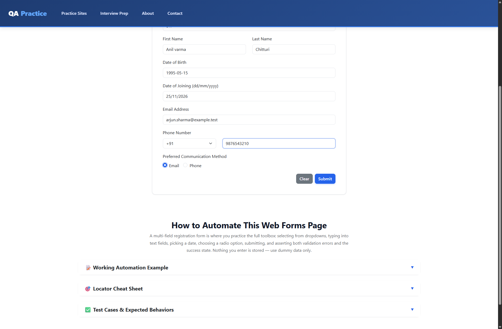
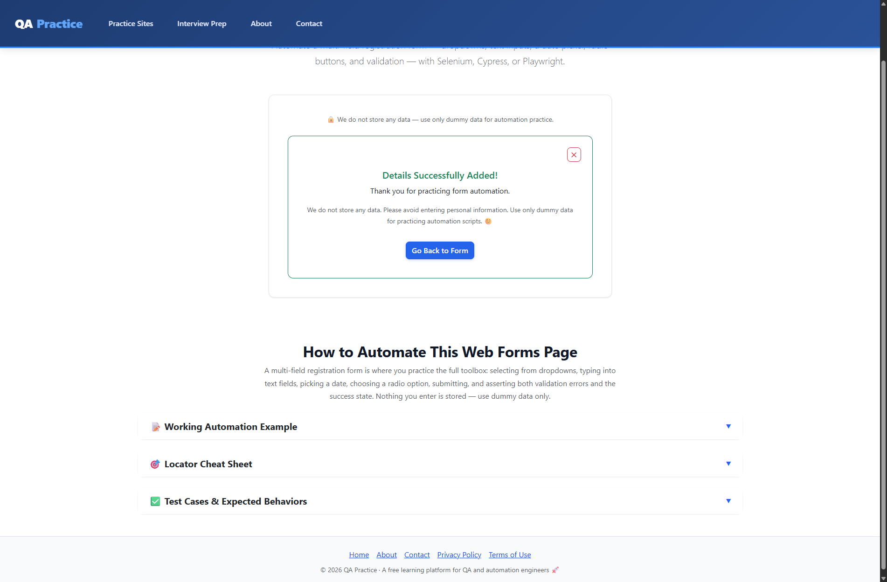

# Practice Form Task Automation

This repository demonstrates a completed Selenium automation task against the
practice form at [qapractice.com/practice-forms](https://www.qapractice.com/practice-forms).
It shows the automated interactions, validation checks, and test results delivered
for the task. It is a demonstration project, not a packaged framework intended for
reuse across other sites or projects.

Only synthetic test data is used.

## Demonstrated work

- Select country, title, and phone-code dropdown values.
- Enter user details and dates, including a dynamically calculated future joining date.
- Verify successful form submission and validation for missing names and invalid emails.
- Check radio-button exclusivity, form reset behavior, and button state.
- Capture test outcomes in shareable pytest HTML reports.

## Screenshots

Screenshots from the task runs are included in [`reports/screenshots/`](reports/screenshots/).

**Completed form**



**Successful submission**



## Task results

| Run | Result | Report |
| --- | --- | --- |
| Chrome full suite | 13 passed, 0 failed | [View report](reports/report.html) |
| Edge smoke run | 4 passed, 0 failed | [View report](reports/edge_smoke_report.html) |

The Chrome report is the latest full-suite run. The Edge report records an earlier
smoke run; it is included as additional task evidence, not a claim that the latest
full suite was run in Edge.

## Run the demonstration

Requirements: Python 3.10 or newer and Google Chrome or Microsoft Edge.

```powershell
py -m venv .venv
.\.venv\Scripts\Activate.ps1
python -m pip install -r requirements.txt
pytest
```

Optionally run headlessly or select a browser:

```powershell
pytest --headless
pytest --browser edge --headless
```

## Files

- `pages/`: Form page object and shared Selenium interactions
- `tests/`: Pytest and unittest demonstrations
- `data/`: Synthetic CSV and JSON test inputs
- `config/config.json`: Target URL, browser, and wait setting
- `reports/`: HTML reports and screenshots from the demonstrated test runs
